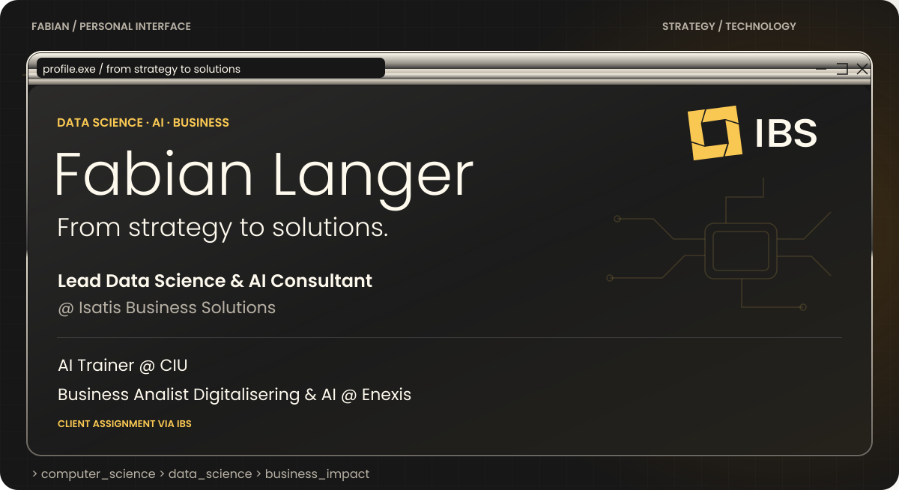
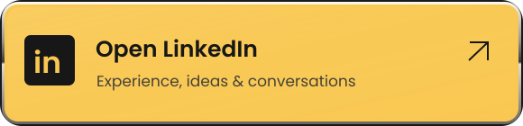
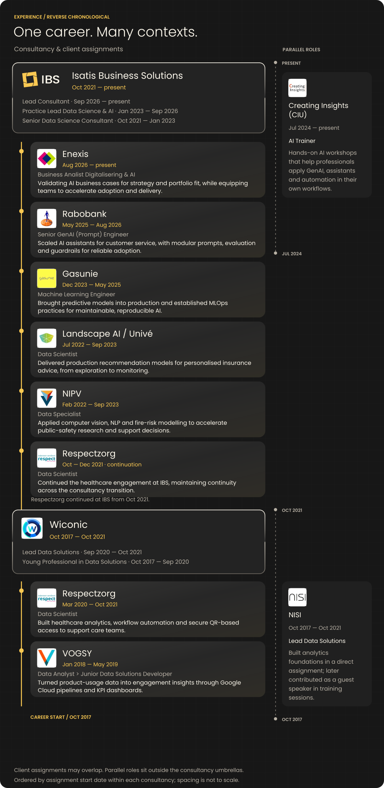
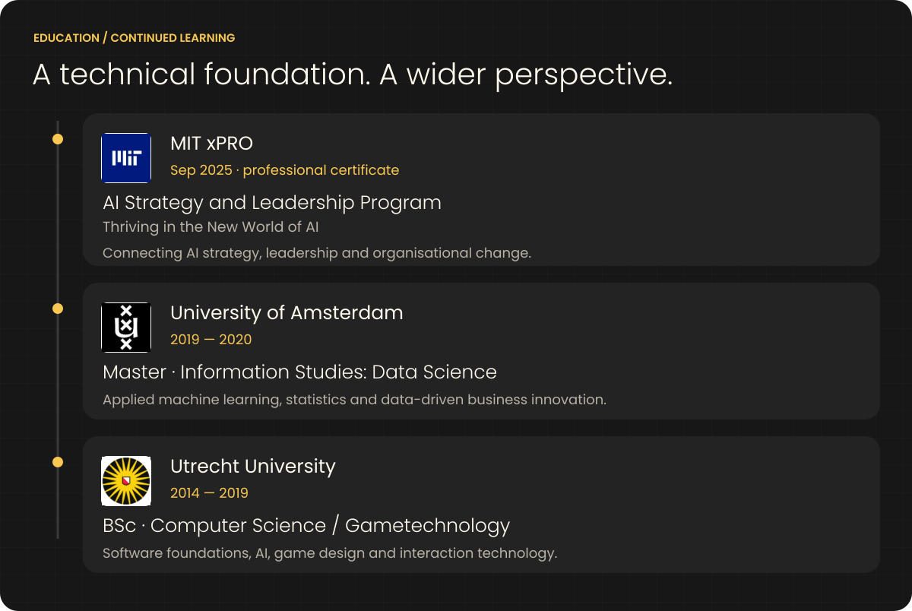

  
  

I help organisations translate AI opportunities into practical solutions: from strategy and business cases to production and adoption. My background in Computer Science, Data Science and ML Engineering connects business ambition with what it takes to deliver responsible AI.

Explore my work and speaking on **[fabianlanger.nl](https://www.fabianlanger.nl/)**, or connect on **[LinkedIn](https://www.linkedin.com/in/fabian--langer/)** for experience, ideas and conversations about AI in practice.

Experience & education · text version

### Isatis Business Solutions · Oct 2021 — present

- Lead Consultant · Sep 2026 — present
- Practice Lead Data Science & AI · Jan 2023 — Sep 2026
- Senior Data Science Consultant · Oct 2021 — Jan 2023

Developing consultants, shaping propositions and connecting data science expertise with client needs.

**Client assignments via IBS**

- **Enexis · Aug 2026 — present** — Business Analist Digitalisering & AI. Validating AI business cases for strategy and portfolio fit, while equipping teams to accelerate adoption and delivery.
- **Rabobank · May 2025 — Aug 2026** — Senior GenAI (Prompt) Engineer. Scaled AI assistants for customer service, with modular prompts, evaluation and guardrails for reliable adoption.
- **Gasunie · Dec 2023 — May 2025** — Machine Learning Engineer. Brought predictive models into production and established MLOps practices for maintainable, reproducible AI.
- **Landscape AI / Univé · Jul 2022 — Sep 2023** — Data Scientist. Delivered production recommendation models for personalised insurance advice, from exploration to monitoring.
- **NIPV · Feb 2022 — Sep 2023** — Data Specialist. Applied computer vision, NLP and fire-risk modelling to accelerate public-safety research and support decisions.
- **Respectzorg · Oct — Dec 2021 · continuation** — Data Scientist. Continued the healthcare engagement at IBS, maintaining continuity across the consultancy transition.

### Wiconic · Oct 2017 — Oct 2021

- Lead Data Solutions · Sep 2020 — Oct 2021
- Young Professional in Data Solutions · Oct 2017 — Sep 2020

**Client assignments via Wiconic**

- **Respectzorg · Mar 2020 — Oct 2021** — Data Scientist. Built healthcare analytics, workflow automation and secure QR-based access to support care teams.
- **VOGSY · Jan 2018 — May 2019** — Data Analyst → Junior Data Solutions Developer. Turned product-usage data into engagement insights through Google Cloud pipelines and KPI dashboards.

Respectzorg ran from March 2020 to December 2021, moving with me from Wiconic to IBS in October 2021.

### Parallel roles

- **Creating Insights (CIU) · Jul 2024 — present** — AI Trainer. Hands-on AI workshops that help professionals apply GenAI, assistants and automation in their own workflows.
- **NISI · Oct 2017 — Oct 2021** — Lead Data Solutions. Built analytics foundations in a direct assignment; later contributed as a guest speaker in training sessions.

### Education & continued learning

- **MIT xPRO · Sep 2025 · professional certificate** — AI Strategy and Leadership Program: Thriving in the New World of AI.
- **University of Amsterdam · 2019 — 2020** — Master · Information Studies: Data Science.
- **Utrecht University · 2014 — 2019** — BSc · Computer Science / Gametechnology.

